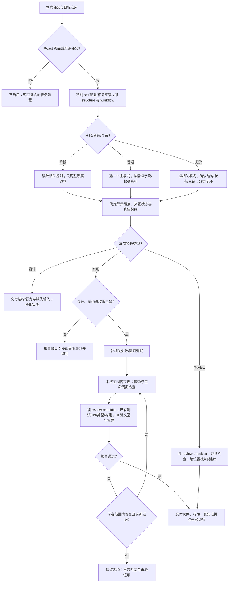

# creating-react-page 维护说明

## 用途与边界

面向不同 React/TypeScript 仓库的页面生成、组件拆分、src 组织设计和结构 Review。采用功能私有内容就近、共享内容分层的默认规范；来源为既有 React 项目的组织模式，经框架与业务解耦提炼。

不用于纯后端、非 React 页面或仅视觉风格讨论。项目特例由目标仓库的指令与真实契约约束，本 skill 不保存里程碑、进度或“已接通”的状态。复制整个目录即可保留相对引用；安装位置与内容复用范围分别验证。

## 文件职责与依赖

- SKILL.md：中文触发描述、输入与边界、按需资料、执行/停止/完成条件。
- references/structure.md：src 各层职责、私有/共享边界、命名、导入、类型、样式与框架适配；每次启用读取。
- references/page-patterns.md：页面、组件、hook 的写法与交互模式及可编译中性示例；页面变更时读取。
- references/data-access.md：service、状态、契约、传输与取消；相关任务读取。
- references/workflow.md：最小输入、片段/普通/复杂分流及复杂页渐进实现；每次启用读取。
- references/fields-and-config.md：字段规格、类型/配置归属、枚举和 UI 适配；字段/表格/表单相关任务读取。
- references/review-checklist.md：共通与各页面模式的验收、证据边界；验证/交付和只读 Review 时读取。
- MAINTAIN.md：维护工作流、验证方法与限制，不是代理执行必读资源。

加载本 skill 不需 API Key、MCP、原业务仓库或额外脚本。实施依赖目标项目已有 React/TS 和所选方案，测试/构建命令从其配置核对；示例需 CSS Modules，不强制目标仓库使用它。中文是作者约定，不是格式硬要求。

## 执行流程图

## 验证方法

- 格式：name 与目录同名、frontmatter 有效、description 范围明确且中文为主；主文档引用直接有效，长引用有目录，无占位或创建者绝对路径。
- 结构覆盖：检查入口及 pages/components/layouts/services/store/utils/constants/typings/styles/assets 均有职责与边界，不以建空目录代替。
- 行为：分别记录宿主发现/选择和执行质量；用显式页面请求、未点名组织请求、近边界负例、只读 Review、缺失接口、失败恢复和取消竞争场景验证。
- 可移植性：在不同 src 根、没有原项目进度文档、已有 fetch/不同状态方案的仓库执行；整体复制到新位置后检查引用。
- 示例：将代码块抽取到临时项目，使用已有编译器检查；实际 UI/请求行为须独立测试，编译通过不证明交互通过。
- 修改依据轨迹和产物；针对受影响路径复测，不为每次失败无边界扩展主文件。

## 已知限制与维护

- 文本规范不能替代 CI 或解析器约束；目录/格式检查不是行为评测。
- 接口不完整时只支持组织设计或明确本地示例，不声称真实服务实现。
- 暂不提供脚手架生成器、动态组件引擎或固定依赖模板。不同构建对 alias/样式处理不同，须按仓库验证。
- 单次试跑不证明隐式选择长期稳定；未测试的宿主、UI 运行和真实网络行为必须披露。
- 本次规则优化的基线：简单查询方案仍选择 services/ping.types.ts；简单页面已能保持内联，但状态归属表与默认 hook 示例存在倾向性冲突。优化集中修正类型默认落点和 hook 依据，不能将已通过的基线行为写成失败。
- 本次前向与保留场景试跑：独立上下文选择 typings 及页面内聚；主从页按独立闭环分配状态，缺接口停止接入，不强装请求库。只读审查不写、纯后端排除；示例身份清理与 UI 类型例外经反馈修订并再次审查。完整示例严格编译、整目录复制与引用/格式检查通过。这些是方案/静态验证，不能扩大为各模式的真实运行覆盖。
- 已实测：格式与五组组织/耦合/引用检查、整体复制后的相对引用、示例 TypeScript 严格编译、独立只读列表/编辑页方案、显式读取与一次未点名选择，以及后端/非 React/纯视觉负例。未实测真实浏览器交互、网络接入或其他宿主；这些不由格式/方案验证替代。
- 执行步骤与边界变化时同一变更更新上述流程图及受影响资源。

## 变更记录

- 2026-10-11：建立通用组织与页面工作流、三个按需引用及维护说明；包括样式/类型/状态/资源而非仅 service。验证按本节方法运行，结果与限制据实际证据维护。
- 2026-10-11：业务类型默认 typings/<domain>.ts；简单页面先内聚、复杂编排/复用才拆 hook。提炼业务页面规则为复杂度分流、字段配置、主从/工作台闭环与按模式验收；不携带来源框架、UI 库 API、业务模块或私人路径。
